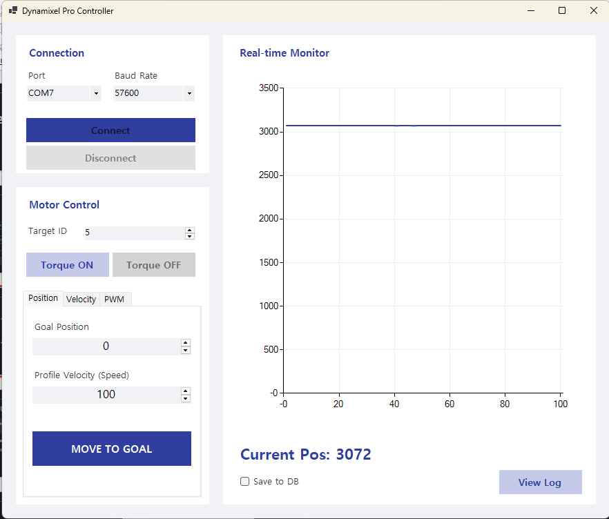

# Dynamixel Motor Monitor

C# WinForms로 만든 **ROBOTIS Dynamixel 모터 제어 및 실시간 모니터링 툴**입니다.
SDK 없이 **Dynamixel Protocol 2.0 패킷을 직접 구성**하여 시리얼 통신으로 모터를 제어하고,
현재 위치를 실시간 그래프로 표시하며 SQLite DB에 로그를 저장합니다.

<!-- 스크린샷: docs/screenshot.png 를 추가한 뒤 아래 주석을 해제하세요 -->
<!--  -->

## 주요 기능

| 기능 | 설명 |
|------|------|
| 시리얼 연결 | COM 포트 / Baud Rate(57600 ~ 4M) 선택 후 연결 |
| Ping | 연결 시 선택한 ID로 PING 패킷을 보내 모터 응답 확인 |
| 토크 제어 | Torque Enable(주소 64) ON / OFF |
| 위치 제어 | Profile Velocity(112) 설정 후 Goal Position(116)으로 이동 |
| 실시간 모니터링 | 50ms 주기로 Present Position(132) 읽기 → 차트에 최근 100개 표시 |
| 데이터 로깅 | 1초 간격으로 위치값을 SQLite(`MotorLog.sqlite`)에 저장, 최근 10건 조회 |

## 기술 스택

- **Language / Framework**: C#, .NET 8 Windows Forms
- **통신**: `System.IO.Ports.SerialPort` (U2D2 등 USB-RS485/TTL 변환기)
- **DB**: `System.Data.SQLite`
- **차트**: `System.Windows.Forms.DataVisualization` (MSChart)

## Dynamixel Protocol 2.0 구현

모든 명령 패킷은 `SendWritePacket` / `SendReadPacket` / `DoPing`에서 직접 조립합니다.

```
| Header        | Reserved | ID | Length(L,H) | Instruction | Params ...      | CRC(L,H) |
| FF FF FD      | 00       | id | n+3         | 01/02/03    | addr, data/len  | crc16    |
```

- **Instruction**: `0x01` PING, `0x02` READ, `0x03` WRITE, 응답은 `0x55` STATUS
- **CRC-16**: 다항식 `0x8005` (CRC-16/BUYPASS) 테이블 방식으로 계산
- **응답 파싱**: 수신 버퍼에서 헤더(`FF FF FD 00`)를 탐색 → Instruction `0x55`, Error `0x00` 확인 후 4바이트 위치값(Little Endian) 추출

## 실행 방법

1. Visual Studio 2022 또는 .NET 8 SDK 설치
2. 빌드
   ```bash
   dotnet build MotorMonitor.sln
   ```
3. 모터를 U2D2 등으로 PC에 연결하고 실행
4. Port / Baud Rate / **Target ID**(모터 ID) 선택 → `Connect`
5. `Torque ON` → Goal Position 입력 → `MOVE TO GOAL`
6. `Save to DB` 체크 시 위치 로그 저장, `View Log`로 확인

> 대상 모델: Dynamixel X 시리즈 (Protocol 2.0 Control Table 주소 기준)

## 프로젝트 구조

```
├─ MotorMonitor.sln
├─ MotorMonitor/
│  ├─ Program.cs               # 진입점
│  ├─ MainForm.cs              # 시리얼 통신, 패킷 생성/파싱, CRC, DB 로깅
│  ├─ MainForm.Designer.cs     # UI 레이아웃
│  └─ MotorMonitor.csproj
└─ docs/
   └─ C# 기반 모터 제어 및 모니터링 툴 제작.pdf   # 발표 자료
```

## 향후 개선 사항

- Velocity / PWM 모드 탭 기능 구현 (Operating Mode 전환 포함)
- 시리얼 수신을 `DataReceived` 이벤트 + 별도 스레드로 분리하여 UI 블로킹 제거
- 다중 모터(Sync Read/Write) 지원
- 로그 CSV 내보내기

## 발표 자료

[C# 기반 모터 제어 및 모니터링 툴 제작 (PDF)](docs/C%23%20기반%20모터%20제어%20및%20모니터링%20툴%20제작.pdf)
